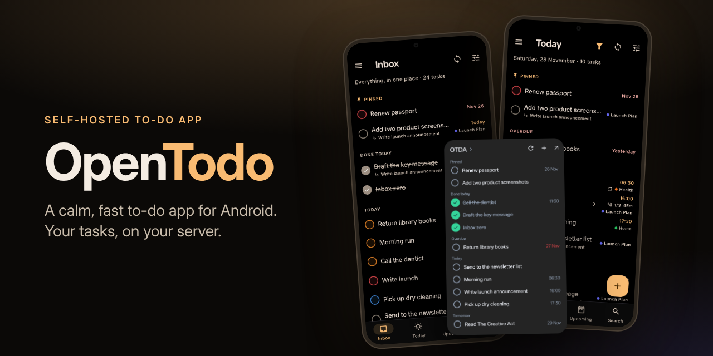
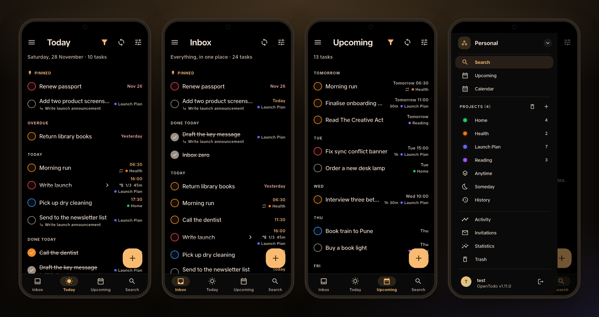
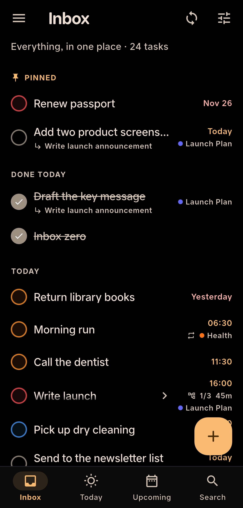
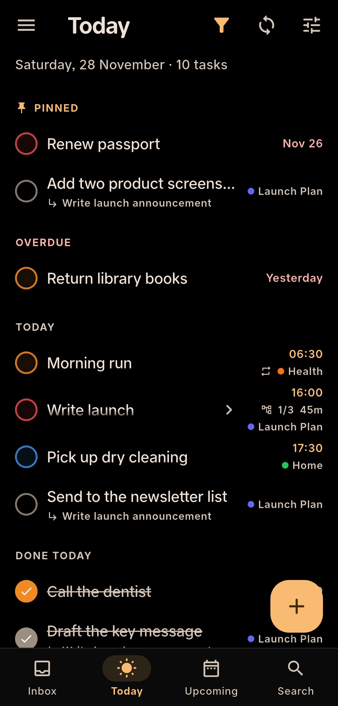
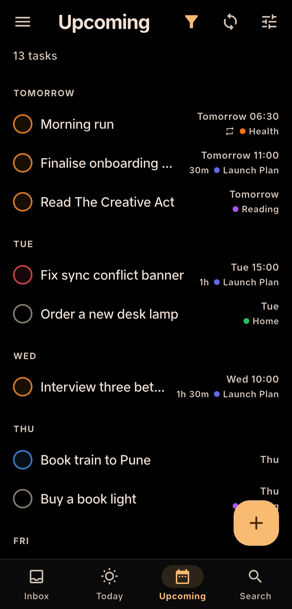
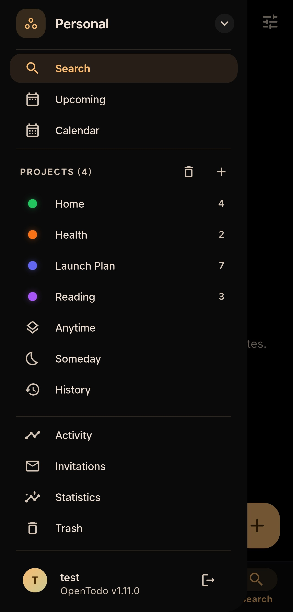
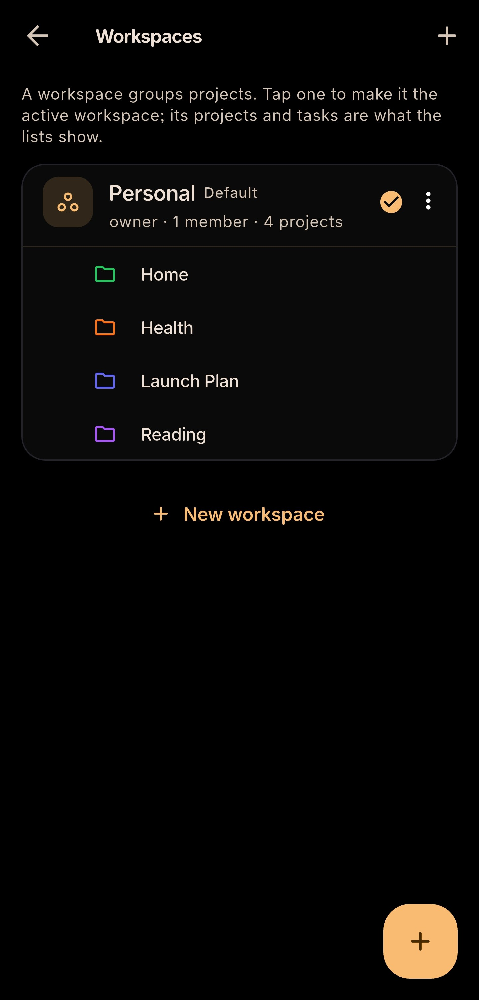
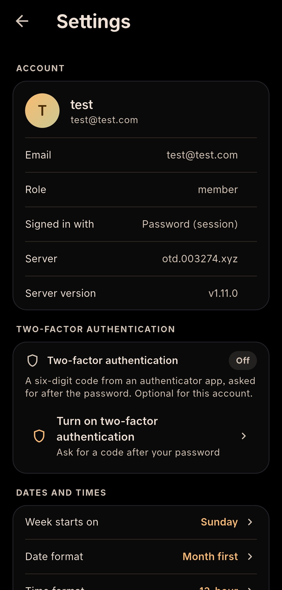
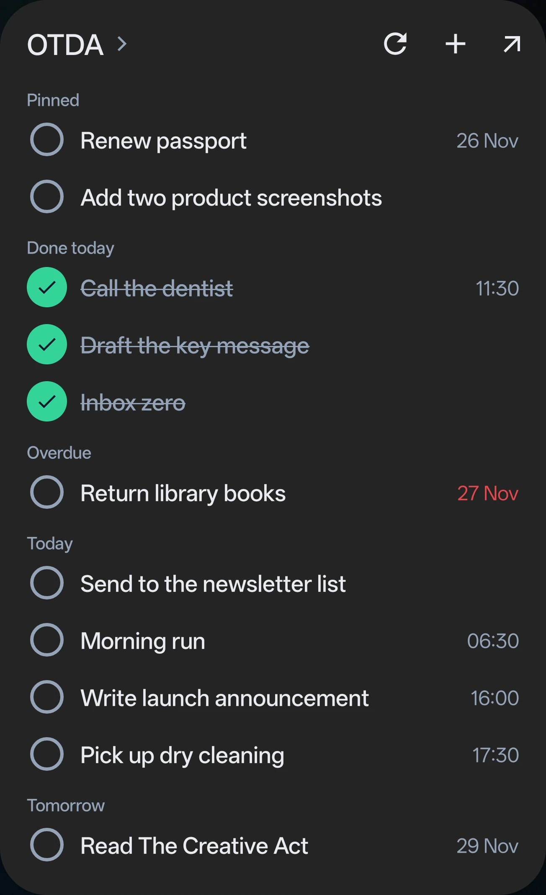

  

# OTDA

**O**pen**T**o**D**o for **A**ndroid — a Flutter client for
[OpenTodo](https://github.com/OpenTodoApp/OpenTodo) servers.

Offline-first, with the same data model as the server so every device converges.

  
  

  

  <i>Your tasks, on your server — pinned work, a daily plan and a widget that stays in step.</i>

- Tasks: projects, sections, labels, priorities, deadlines, start/Someday,
  estimates, energy, subtasks, repeating occurrences and a Trash with restore.
- Views: Inbox, Today, Upcoming, Anytime, Someday, History, Search, a month
  calendar and project lists.
- Workspaces and sharing: switch or create workspaces, share projects with roles
  and invitations, and publish read-only or tickable public links.
- Capture: quick-add from one line, reminders, the Android home-screen widget and
  a quick-add popup.
- Security: optional end-to-end encryption with a recovery key, app lock, TOTP
  two-factor, per-task history and JSON/ZIP export.
- Notes: Markdown with headings, lists, quotes, code, tables, links and tappable
  checklists.
- Not yet: comments, images inside notes, an in-app PDF viewer, note public pages,
  and the device relay.

- Package / bundle id: `com.dw.otda`
- Target server: OpenTodo **v1.11.0** (`/api/v1`), backward-compatible with
  **v1.5.0 and later**; see [the 1.11 impact note](docs/opentodo-1.11-impact.md)
- Platforms: Android, iOS (the home-screen widget, the quick-add popup and the
  exact-alarm reminders are Android only)

## Screens

  

  Today, Inbox, Upcoming and the workspace drawer — one local replica, every screen in step.

<table align="center">
  <tr>
    <td align="center" width="33%">
      
       
      <b>Inbox</b> Everything, in one place
    </td>
    <td align="center" width="33%">
      
       
      <b>Today</b> Pinned, overdue and done
    </td>
    <td align="center" width="33%">
      
       
      <b>Upcoming</b> The days ahead
    </td>
  </tr>
  <tr>
    <td align="center" width="33%">
      
       
      <b>Projects</b> Projects and navigation
    </td>
    <td align="center" width="33%">
      
       
      <b>Workspaces</b> Projects, members and access
    </td>
    <td align="center" width="33%">
      
       
      <b>Settings</b> Account, security and dates
    </td>
  </tr>
</table>

### The widget

  

  The same pinned tasks and Done today, above the rest of the day — without opening the app.

## Documentation

The product overview stays here. The engineering notes live in the docs:

| Guide | What it covers |
| --- | --- |
| [Architecture and repository map](docs/architecture.md) | The three layers, the Android process model, and where each part of the repo lives. |
| [The quick-add parser](docs/quick-add-parser.md) | The grammar, examples, live highlighting, and how to add a phrase or language. |
| [Data model and sync](docs/data-model-and-sync.md) | The local replica, op log, hybrid clock, conflict rule and repeating-task records. |
| [Reminders](docs/reminders.md) | The pure planner, Android alarms and snooze handling. |
| [The home-screen widget](docs/home-screen-widget.md) | Snapshot building, native rendering, tap actions and widget look settings. |
| [Settings](docs/settings.md) | Account preferences versus device-only settings, and the server tab. |
| [Sign-in](docs/sign-in.md) | Sessions, API tokens and the platform keystore. |
| [Testing](docs/testing.md) | Local commands, test groups and the integration server. |
| [Releasing](docs/releasing.md) | CI, the release workflow and the signing secrets. |
| [API spec](docs/api-spec.md) | Regenerating spec/API.md and the filtered OpenAPI file. |
| [OpenTodo 1.11 compatibility](docs/opentodo-1.11-impact.md) | What changed upstream and what it means for OTDA. |

## Install

- **Android:** install from Google Play, or add the GitHub repo to Obtainium.
- **iOS:** build from source with Flutter; the Android-only pieces are the widget,
  quick-add popup and exact-alarm reminders.
- **Server:** OpenTodo **v1.5.0 or later**; OTDA currently targets **v1.11.0**.

## Privacy

OTDA collects nothing: no analytics, no ads, no crash reporting, and no server of
ours. Your tasks stay on your device and go only to the OpenTodo server you sign
in to. The full policy is [PRIVACY.md](PRIVACY.md).
