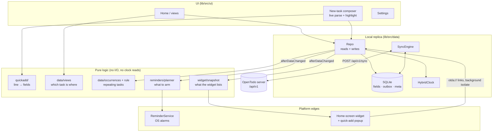
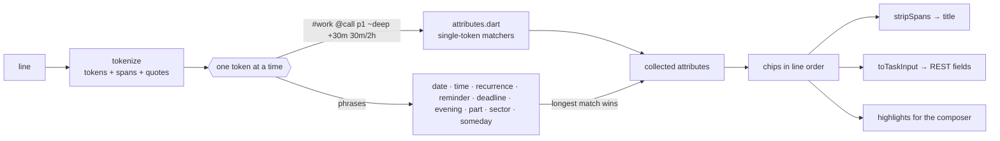
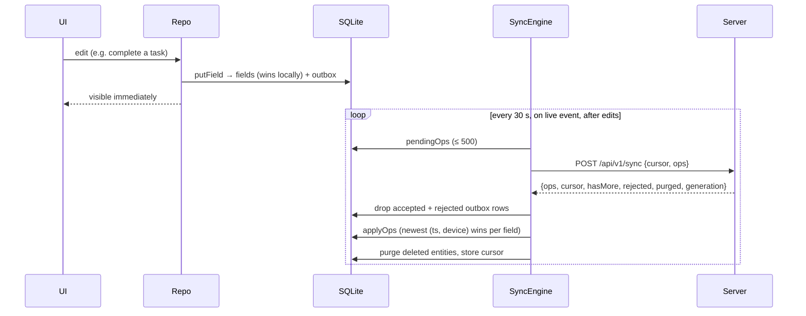
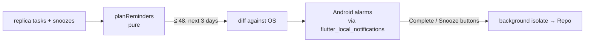

<p align="center">
  
</p>

# OTDA

**O**pen**T**o**D**o for **A**ndroid — a Flutter client for
[OpenTodo](https://github.com/OpenTodoApp/OpenTodo) servers.

Offline-first, with the same data model as the server so every device converges.

<p align="center">
  <a href="https://apps.obtainium.imranr.dev/redirect?r=obtainium://add/https://github.com/driftywinds/OTDA">
    
  </a>
  <a href="https://play.google.com/store/apps/details?id=com.dw.otda">
    
  </a>
</p>

- Tasks with deadline, start/Someday, estimate, energy, section, labels, subtasks,
  a Trash with restore and purge, and repeating occurrences.
- Workspaces: switch, create, rename, move projects between them, see members and
  groups, leave and transfer ownership. Projects can be shared with other accounts by
  email, with a role that can be changed or removed; invitations can be accepted or
  declined from the app.
- Public links: a project can be published as a read-only (or tickable) page with an
  expiry, and a task as a view/reply/tick page. The URL is shown once, then revocable.
- Inbox is the consolidated view: Done today, Today, Upcoming, Anytime and Someday
  across every project. Other views: Today, Upcoming (ending with Anytime), Anytime,
  Someday, History, Search, project lists, a month calendar, reminders and the
  home-screen widget.
- Two-factor authentication management (enrol, recovery codes, trusted browsers),
  statistics, a shared-project activity feed, per-task history, JSON/ZIP export and
  device-local theming.
- End-to-end encryption: turn it on from Settings with a one-time recovery key, rewrite
  existing content with progress (interrupted runs resume), encrypt plaintext as it
  arrives, purge old content history, and turn it off again with a fresh confirmation.
  The account key is remembered on the device after the first passphrase unlock. App
  lock is a separate, off-by-default fingerprint/face/device-PIN gate for the UI.
- Attachments: pick files, encrypt personal ones with the `OTAT1` chunked format, upload
  with size/sha256, verify every chunk on open, view images in-app and share the rest.
  Enabling or disabling encryption re-uploads existing files as new rows first.
- Not yet: notes/comments, link attachments, an in-app PDF viewer, note public pages,
  and the device relay.

- Package / bundle id: `com.dw.otda`
- Target server: OpenTodo **v1.8.0** (`/api/v1`), backward-compatible with
  **v1.5.0 and later**; see [the 1.8 impact note](docs/opentodo-1.8-impact.md)
- Platforms: Android, iOS (the home-screen widget, the quick-add popup and the
  exact-alarm reminders are Android only)

## Contents

1. [What is here](#what-is-here)
2. [Architecture at a glance](#architecture-at-a-glance)
3. [The quick-add parser](#the-quick-add-parser) — the part worth reading first
4. [The data model and sync](#the-data-model-and-sync)
5. [Reminders](#reminders)
6. [The home-screen widget](#the-home-screen-widget)
7. [Settings](#settings)
8. [Sign-in](#sign-in)
9. [Test it](#test-it)
10. [Releasing](#releasing)
11. [Regenerate the API spec](#regenerate-the-api-spec)
12. [Privacy](#privacy)

## What is here

| Path | What it is |
| --- | --- |
| `spec/API.md` | The confirmed API surface: **400 `/api/v1` operations**, every one probed against a live v1.5.0 server, AI surface excluded. |
| `spec/OTDA.openapi.json` | The same surface as OpenAPI 3.1, filtered to what this app uses. |
| `spec/*.py` | The scripts that produced it (route table of tag `v1.5.0` + live probes + the repo's OpenAPI). |
| `lib/src/api/` | HTTP client: bearer token or session cookie, error envelope, no redirects. |
| `lib/src/auth/` | Health check, password sign-in, second factor, step-up (`reauth`), token sign-in, TOTP enrolment/recovery codes/trusted devices. |
| `lib/src/data/` | The local replica: per-field last-writer-wins, op outbox, hybrid logical clock, sync engine, view rules, statistics, activity/history and export clients. |
| `lib/src/quickadd/` | The quick-add parser, ported from the web app with its shared vectors. |
| `lib/src/reminders/` | The reminder planner (pure) and the service that arms it with the OS. |
| `lib/src/widget/` | The widget snapshot builder (pure) and the widget's look settings. |
| `lib/src/ui/` | Screens and sheets: home, composer, task sheet, Trash, statistics, activity, invitations, export, workspaces, project sharing, public links, task pages, settings, admin. |
| `android/.../widget/` | The home-screen widget (plain RemoteViews with a scrolling list) and its project picker (Kotlin). |
| `test/` | Unit tests, parity fixtures (`inbox`, `views`, `quickadd` vectors), and integration tests against a real server. |
| `tool/parse_check.dart` | Prints what the parser makes of a line: `dart run tool/parse_check.dart "call Sam tomorrow 3pm p1"`. |

## Architecture at a glance

OTDA is three layers around one local database. Nothing in the UI talks to the
server; everything reads and writes the **replica** on the phone, and a sync
loop reconciles it with the server in the background.



Three rules hold the design together:

1. **One write path.** Every change — a tap in the app, a tick in the widget, a
   task typed into the popup — is a field write plus a queued op in `Repo`.
   It is visible at once and reaches the server on the next exchange.
2. **One trigger for side effects.** `AppState.afterDataChanged()` runs after
   every finished sync and every local change. It rewrites the widget snapshots
   and re-arms reminders, in that order, each in its own `try`, so a refused
   notification permission can never stop the widget updating.
3. **Pure cores, thin edges.** The parser, the view rules, the recurrence
   rules, the reminder planner and the widget snapshot are plain functions of
   their inputs (including "today" and "now", which are *passed in*). Plugins,
   the database and the clock sit at the edges. That is why most of the test
   suite needs no device.

### Process model on Android

| Entry point | What runs | Why it exists |
| --- | --- | --- |
| `main()` → `MainActivity` | The full app: `AppState`, sync loop (30 s poll plus a live event stream), UI. | Normal use. |
| `quickAddMain()` → `QuickAddActivity` | Only the composer, in its own transparent Flutter engine. | The widget's "+" opens fast over whatever app is in front and never touches the main UI. |
| `onWidgetAction()` (background isolate) | Opens the replica headlessly (`openHeadlessRepo`), applies the action, rewrites snapshots. | Ticking a task in the widget works with the app closed. |

The widget talks to Dart through `otda://` links (`task`, `new`, `complete`,
`refresh`, `upcoming`). `MainActivity` hands them to `SystemBridge`, which routes
them in `handleWidgetUri`.

## The quick-add parser

`lib/src/quickadd/` turns one line of free text into a task:

```
Write report tomorrow #work @call p2 +45m
```

```json
{
  "title": "Write report",
  "due": { "date": "2026-10-10" },
  "project_id": "w",
  "labels": ["l-call"],
  "priority": 2,
  "estimate_minutes": 45
}
```

It is a port of the web app's `web/src/lib/nlp` (OpenTodo v1.5.0, including the
v1.8 dashed-range rule), kept behaviour-identical and checked against the **same
306 shared test vectors** the web and Go implementations run
(`test/quickadd/quickadd.vectors.json`). It runs
entirely on the device, so the preview works offline and updates as you type.

### Design principles

- **Pure and deterministic.** `parse(line, ctx)` depends only on the line, the
  reference date (`today`), the wall clock (`now`), the active languages, the
  project list and the dismissed spans. No clock reads, no randomness, no time
  zones (dates are floating `YYYY-MM-DD` strings, times floating `HH:MM`).
- **Never emit what the server would refuse.** Recurrence phrases are translated
  into the canonical English rule and only accepted if `parseRule` accepts them.
- **Explicit only.** The result carries only attributes the line actually set,
  so view defaults fill the rest (a bare `Buy milk` yields just `{title}`).
- **Quotes are literal.** Words inside a balanced pair of `"…"` are never
  matched by any grammar.
- **Cheap to get wrong, easy to undo.** Anything ambiguous prefers to stay in
  the title (a bare `4m` could be metres; `from September` is prose).

### Pipeline



| File | Responsibility |
| --- | --- |
| `tokenize.dart` | Splits on whitespace into `Token`s (`text`, folded `norm`, `start`, `end`, `quoted`) and reports the quote characters of balanced pairs. `stripSpans` builds the title by turning every recognised span into a word break, so `milk tomorrow p2` never glues words. |
| `vocab/` | One `Vocabulary` per language (`en`, `de`, `fr`, `it`, `es`, `pt`, `nl`): day words, weekdays, months, "in/at/on/by", units, am/pm, ordinals, recurrence words. `normalize()` folds case, diacritics and `ß`, so vocabularies are written in natural spelling. English is always active; extra languages are *added*, not swapped. |
| `attributes.dart` | The language-independent single tokens: `#project` (exact folded name, then unique prefix, `#Parent/Child` paths), `@label`, `p1`–`p4`, `~deep`/`~medium`/`~low`, durations (`+45m`, `+1h30`) and spent/estimate (`30m/2h`). |
| `dates.dart` | The date and time grammar and resolver: day words, weekdays, `next …`, ordinal weekdays, `in N <unit>`, `D month [year]`, numeric dates (order from the date-format preference), clock times (`3pm`, `15:30`, `noon`, Dutch `half 4`; a bare `15h` is a time only in a language that writes times that way — in English it is a 15-hour estimate). |
| `recurrence.dart` + `rule.dart` | Recurrence phrases → canonical rule (`every monday`, `every 2 weeks on saturday`, `every 3 days after completion`, `until`, `for N times`, "every other"), `parseRule`, `firstOccurrence`, and `compatibleRule` (written in the form a 1.0 client reads). |
| `reminders.dart` | `remind me 30 min before` (offset) or `remind me tomorrow at 9` (moment), and how a reminder resolves against the final due date. |
| `sectors.dart` | Time sectors (`this week`, `next quarter`) → the stored ISO week / month / quarter. |
| `parse.dart` | The loop that ties it all together, plus the `Chip`/`ParseResult` types and dismissal bookkeeping. |
| `types.dart` | The floating `Due` value the whole grammar returns (`date`, optional `time`); there is no time zone or instant anywhere in it. |
| `quickadd.dart` | The public entry point `parseQuickAdd`, `toTaskInput` (label and project resolution into the REST body), chip labels, Backspace/dismissal helpers. |
| `settings.dart` | Language resolution and numeric date order from the user's preferences. |
| `../quickadd_bridge.dart` | The app-side wrapper `parseLine`: supplies today/now, project refs, and converts chips to preview labels and highlights. |

### How one pass reads a line

`parse()` walks the tokens left to right, exactly once. At each token it tries,
in this order:

1. **Single-token attributes** (`#`, `@`, `~`, `p1`, durations). The first
   `#project` and the first priority win; every `@label` accumulates, and every
   `~energy` token is collected with the **last** one setting the value.
2. **Deadline words** — `deadline friday`, `by friday` (a `by` date followed by
   a time stays a due date instead).
3. **Evening / part words** — `tonight`, `this evening`; `this morning` /
   `this afternoon` when the account uses day parts. These also set today as the
   date when none came first.
4. **The phrase contest.** At the same token, a date, a time, a recurrence and a
   reminder matcher each report how many tokens they consume. **The longest
   wins; a date wins a tie.** Then the first date, first time and first rule are
   kept; reminders accumulate.
5. **Sector / someday** words, which only count if the line ends with no date.

Because matching is longest-wins, phrases that *contain* smaller phrases come
out whole:

| Line | Read as | Not as |
| --- | --- | --- |
| `gym every 2 weeks on Saturday` | one recurrence | a date plus a time plus text |
| `remind me tomorrow at 9` | one reminder moment | a due date and a due time |
| `lunch Monday, March 3` | one date (the 3 March) | a weekday and a date |
| `invoices from September` | text (a bare month after *from* stays prose) | a date |
| `September 3` | a date | — |
| `every 2 Mondays` | kept whole in the title (a *literal* match the grammar cannot express) | `every Monday` plus a stray `2` |

The same machinery implements a few deliberate asymmetries: a bare month is
replaced by a later complete date, a "someday" phrase is discarded if the line
has a date, and only the first recurrence rule counts after which only literal
matches are consumed.

### Examples

Reference for all of these: today is Friday **2026-10-09**, now is **10:00**,
English, a project named *Work* (`w`).

| You type | Title | Result |
| --- | --- | --- |
| `Water plants every Monday` | `Water plants` | recurrence `every monday`, due `2026-10-12` |
| `Call Sam tomorrow 3pm p1` | `Call Sam` | due `2026-10-10 15:00`, priority 1 |
| `Write report tomorrow #work @call p2 +45m` | `Write report` | due `2026-10-10`, project `w`, label `call`, priority 2, estimate 45 min |
| `Pay rent deadline friday` | `Pay rent` | deadline `2026-10-16` (no time: a time after a deadline stays in the title) |
| `Tidy desk tonight` | `Tidy desk` | due today, evening flag |
| `Read paper someday` | `Read paper` | parked (`start: someday`), no date |
| `Draft ~deep 30m/2h` | `Draft` | energy deep (if energy is on); spent 30 min of a 2 h estimate |
| `Stretch remind me 30 min before` | `Stretch` | reminder: 30 minutes before the due |
| `Standup every weekday at 9:30` | `Standup` | recurrence `every weekday`, due time `09:30` |
| `Buy "tomorrow" candles` | `Buy tomorrow candles` | no date: quoted words are literal, the quote marks are dropped |
| `Buy milk` | `Buy milk` | nothing but the title |

#### Relative phrases: `in <n><unit>`

"In N units" works spoken (`in 4 minutes`, `in a week`) and compact. The
compact suffix is language independent, like `+30m`, and only counts directly
after an *in* word (`in` in English, `dans`, `tra`, `en`, `em`, … in the others):

| Suffix | Unit | Example | Resolves to (today 2026-10-09, now 10:00) |
| --- | --- | --- | --- |
| `m`, `min`, `mins` | minutes | `call in 4m` | due today **10:04** |
| `h`, `hr`, `hrs` | hours | `call in 2h` | due today **12:00** |
| `d` | days | `call in 3d` | due **2026-10-12** |
| `w`, `wk`, `wks` | weeks | `call in 2w` | due **2026-10-23** |
| `mt`, `mth`, `mths`, `mo`, `mos` | months | `call in 3mt` | due **2027-01-09** |
| `y`, `yr`, `yrs` | years | `call in 1y` | due **2027-10-09** |

Details worth knowing:

- Minutes and hours are a **time** (wall-clock now plus the amount, on the day
  it lands on): `in 4m` typed at 23:58 gives `00:02` tomorrow. Days and longer
  are a **date**. Months clamp to the end of a shorter month.
- A bare `m` is **minutes**; months are `mt`/`mo`/`mth`. A leading `+` is
  unchanged and always means *duration*: `write +4m` is a 4-minute estimate, not
  a due time.
- Without `in`, a bare `4m` is left alone in the title (it could be metres).
- Minutes and hours need a wall clock (`now`); without one only the date forms
  resolve.

#### What "understood" looks like: chips

Each recognised attribute becomes one **chip**: its `kind`, the character
`spans` it came from, and its resolved `value`.

```text
line:  "  call tomorrow 3pm p1"            (two leading spaces, as typed)
chips: due      spans [tomorrow] [3pm]   → Due(2026-10-10 15:00)   spanKinds [date, time]
       priority spans [p1]               → 1
```

The preview chips under the input are `chipLabel(chip)`. A `due` chip may own two
spans (the day phrase and the clock phrase); `spanKinds` says which is which.

#### Live highlighting

While you type, every understood phrase is coloured by kind, the way TickTick
does it (`ui/highlight_controller.dart`):

| Kind | Colour | Kind | Colour |
| --- | --- | --- | --- |
| date | blue | project | green |
| time | amber | label | cyan |
| recurrence | purple | priority | orange |
| reminder | pink | energy | lime |
| deadline | red | estimate / spent | gold |
| evening / part of day | indigo | someday / sector | teal |

How it stays smooth:

1. `parseLine` returns a `ParseHighlight(start, end, kind, text)` per span.
   Offsets are shifted back onto the line **as typed**, because the parser sees
   the trimmed line.
2. The composer parses after a 180 ms pause and hands the list to its
   `HighlightingController`.
3. Parsing lags behind typing, so a highlight is only painted while the text at
   its position is *still the same*. Typing after a phrase keeps it coloured;
   editing inside it drops the colour until the next parse.
4. `buildTextSpan` cuts the text at every highlight and IME-composing boundary,
   so the keyboard's composing underline survives.
5. The controller's listener only re-parses when the **text** changed (not on
   caret moves or its own highlight updates), which avoids a notify loop.

#### Dismissals

The port includes the web app's "Backspace un-parses the last chip" bookkeeping:
`chipAtCaret`, `dismissChip`, `liveDismissals` and `rebaseDismissed`. A dismissed
span is skipped while the line still has exactly that text there, and is shifted
or dropped as the line is edited. (The composer does not wire a Backspace
gesture to these yet.)

### Composer: who owns each value

The new-task sheet has both a typed line and tappable controls (date, time,
duration, repeat, priority, project). `ComposerState` records **who set each
field**:

- A value a control set is *manual* and the line never overwrites or clears it.
- A value from the line is cleared when the line stops saying it — delete the
  word `tomorrow` and the date goes.
- Clearing a control releases the field so the line may fill it again.

`composeTaskFields` merges the two when saving. Label names from the line are
resolved to ids (created on demand) by `Repo.resolveLabelNames`. Reminders and
spent time parsed from the line are shown in the preview but not yet written;
they need their own calls.

### Adding to the grammar

- **A new word in an existing language** → edit its `vocab/<lang>.dart`.
- **A new language** → add a `Vocabulary`, register it in `vocab/index.dart`.
- **A new phrase shape** → add a matcher to `dates.dart` / `recurrence.dart` /
  `reminders.dart` returning *token counts*, so the longest-wins contest in
  `parse()` arbitrates it for free.
- **Always** add a case to `test/quickadd/` (and, for shared behaviour, the
  vectors file, which must stay identical to the web copy).

## The data model and sync

The server is a field-level last-writer-wins op log. This app keeps the same
shape locally: `fields(entity, entity_id, field, value, ts, device)`, plus an
`outbox` and a `meta` table. Every edit is `(ts, device)`-stamped, applied
locally at once, and pushed by the next exchange. Pulling applies the same
comparison, so a device that was offline for a week ends up identical to one
that never left.



- **Conflict rule.** `applyField` writes a value only if its `(ts, device)` is
  greater than the stored pair (timestamp first, device id breaks ties), so
  every replica picks the same winner per field, in any order.
- **Hybrid logical clock.** A stamp is `max(now + offset, last + 1)`, so a local
  write always orders after anything already seen. The clock adopts the
  server's time when the two differ by more than 2 s, so a phone with a wrong
  clock does not stamp far in the future.
- **Entities are bags of fields.** Rows are decoded maps keyed by the server's
  field names; a new server field shows up in `Task.raw` without a migration.
- **Deletes are tombstones** (a `deleted_at` field), so other devices learn of
  them; the server's `purged` list removes rows for good.
- **Server restored from backup?** The `generation` changes; the engine re-emits
  every stored field with its stored clock (`_reseed`) and reads the log again.
- **Failures.** An unreachable server is only reported after two failures in a
  row, in plain words (`FailureMeter`); a server that answered "no" is reported
  at once.
- **Repeating tasks** are a *series* plus one *occurrence record* per finished
  day (`series.dart`). Ticking a repeating task writes the record (its id is a
  deterministic UUID of `occurrence:<series>:<date>`, so every client lands on
  the same row) and moves the series to its next date, instead of completing it.
  `occurrences.dart` expands a rule into dated occurrences for the calendar,
  Upcoming and the reminder planner.
- **View rules** (`views.dart`) are ported from the web app and pinned by the
  `inbox` / `views` vectors, so OTDA lists exactly what the web app lists.

## Reminders



- `planner.dart` is pure: every open occurrence in a 3-day window that is still
  ahead becomes a `PlannedReminder`. A task with a date but no time uses a
  default (09:00, configurable). Wall-clock times are built in the device's time
  zone, so 9:00 stays 9:00 across a daylight-saving change. The id is a stable
  31-bit hash of `taskId|day`, so the same occurrence replaces the same alarm.
- `ReminderService.rearmFrom(repo)` is the **only** thing that schedules
  anything; calls queue up so a re-arm requested during another is not lost.
- Snoozes are a per-device decision and are **never synced**.
- Settings → Notifications shows permission, exact-alarm and battery state, and
  has test buttons and a copyable debug log.

## The home-screen widget

```mermaid
flowchart LR
  R[Repo] --> B[buildWidgetSnapshot<br/>pure: sections, rows, 'more']
  B -->|JSON via home_widget<br/>snapshot_all, snapshot_‹projectId›| P[(HomeWidgetPreferences)]
  S[WidgetSettings<br/>look] --> P
  P --> G[Widget (RemoteViews)<br/>never computes anything]
  G -->|tap row| Link[otda://task/…]
  G -->|tick circle| C[CompleteAction → otda://complete]
  G -->|+| Q[QuickAddActivity popup]
```

- **Dart decides, Kotlin draws.** `buildWidgetSnapshot` produces the whole list
  (Overdue / Today / Tomorrow / This week / Later, rows sorted by day and time,
  a `more` count). The widget code only renders it. Snapshots are written for
  "all" and for each project that has a widget (`active_projects`).
- **No snapshot yet?** The widget asks Dart for one (throttled to once a minute)
  through a background broadcast, so a freshly placed widget fills itself.
- **Ticking is optimistic.** `CompleteAction` flips the row in the stored
  snapshots immediately, then the background isolate writes the real change and
  rewrites every snapshot.
- **Project per widget.** The picker (`TasksWidgetConfigActivity`, plain Views)
  works with the Flutter engine dead; it reads `projects_index` from the same
  preferences.

### Widget look (Settings → Home screen widget)

Per device, stored next to the snapshot, applied immediately. The keys and
defaults are mirrored in `widget/widget_settings.dart` and `WidgetStyle` in
`TasksWidget.kt` — change both together.

| Setting | Key | Values | Default |
| --- | --- | --- | --- |
| Text size | `widget_text_scale` | 70–160 (%) | 100 |
| Row spacing | `widget_density` | `compact` · `standard` · `roomy` | `standard` |
| Widget theme | `widget_theme` | `system` · `light` · `dark` | `system` |
| Background opacity | `widget_background` | 20–100 (%) | 100 |
| Section headings | `widget_show_sections` | bool | true |
| Due time and date | `widget_show_due` | bool | true |
| Completed tasks | `widget_show_completed` | bool | true |

Text size scales every font and grows rows and tap targets with it (never below
their base size). Titles are ellipsized by the TextView itself —
so a larger font keeps proportionally fewer characters. A section heading with
nothing left under it (for example after hiding completed tasks) is dropped.
Values are plain ints, strings and bools so the native side needs no special
decoding, and a missing or odd value is simply the default.

## Settings

Two kinds, shown in one screen:

- **Account preferences** (`week_start`, `date_format`, `time_format`,
  `row_layout`, …) live in the op log under `user_prefs/me` and **follow you to
  every device** on the next sync. `system` means "follow this phone".
- **This device** (theme mode, independent dark/AMOLED style, accent, density, row
  detail, font, notification options, widget look) is stored locally and never
  synced. An instance theme read after sign-in supplies the default palette until
  an accent is chosen.
- **Security** is account state, not a preference: Settings → Two-factor
  authentication enrols TOTP, shows recovery codes once, lists remembered browsers
  and turns the factor off (each change asks for a fresh password or code).

Admins and owners get a second **Server** tab (`admin_view.dart`) over the admin
API.

## Sign-in

Session cookie first (email + password, second factor, step-up for the
credential routes), API token second. The token is for scripts and for servers
where single sign-on has closed password sign-in. Credentials live in the
platform keystore (`flutter_secure_storage`), never in shared preferences.

## Test it

```powershell
$env:APPDATA="$PWD\.tmp\appdata"; $env:LOCALAPPDATA="$PWD\.tmp\localappdata"
$env:PUB_CACHE="$PWD\.tmp\pub-cache"; $env:HOME="$PWD\.tmp\home"
$env:TEMP="$PWD\.tmp\temp"; $env:TMP=$env:TEMP
$env:ANDROID_HOME='W:\repos\librarium-android\.tooling\android-sdk'
$env:GRADLE_USER_HOME="$PWD\.tmp\gradle"; $env:ANDROID_USER_HOME="$PWD\.tmp\android-user"

.flutter\flutter.bat test --exclude-tags integration   # what CI runs
.flutter\flutter.bat test --tags integration           # needs the server below
.flutter\flutter.bat analyze
.flutter\flutter.bat build apk --release --split-per-abi
```

| Area | Tests |
| --- | --- |
| Parser | `test/quickadd/` — the shared vectors, a port of the web unit tests, the NLP grammar tests, and `relative_test.dart` (`in 4m`, `in 3d`, …, highlights, the highlighting controller) |
| Composer | `composer_state_test`, `compose_task_test`, `new_task_sheet_test` |
| Data and sync | `sync_exchange_test`, `live_update_test`, `sync_gate_test`, `apply_ops_test`, `series_completion_test`, `occurrences_test`, `recurrence_test`, the `inbox` / `views` vector tests |
| Tasks and Trash | `task_metadata_test`, `repo_metadata_test`, `subtasks_test`, `trash_test`, `trash_flow_test` |
| Workspaces | `workspace_test`, `workspace_flow_test` |
| Sharing | `sharing_test`, `sharing_flow_test`, `invitation_test`, `invitation_flow_test`, `public_links_test`, `public_links_flow_test` |
| Read and account | `stats_test`, `activity_flow_test`, `export_test`, `export_flow_test`, `mfa_flow_test`, `theme_palette_test`, `e2ee_lifecycle_test`, `biometric_test`, `file_crypto_test`, `attachments_test` |
| Reminders and widget | `reminder_planner_test`, `widget_snapshot_test`, `widget_settings_test` |
| UI | `settings_rows_test`, `theme_smoke_test`, `views_test`, `calendar_month_test` |

The integration tests are tagged and expect a server at `http://127.0.0.1:18080`
with the account `dev@otda.local`. Start one from the release binary:

```powershell
$env:OPENTODO_ADDR='127.0.0.1:18080'; $env:OPENTODO_DATA_DIR="$PWD\.tmp\server\data"
.\.tmp\server\opentodo.exe
```

To check the real dataset on a live server (read-only):

```powershell
flutter test test/remote_pull_test.dart --dart-define=OT_SERVER=https://… --dart-define=OT_TOKEN=ot_…
```

## Releasing

Two workflows, adapted from the scrobbler project:

- `.github/workflows/ci.yml` — analyze, unit tests (integration tags excluded) and
  a release APK build on every pull request and push to `main`.
- `.github/workflows/release.yml` — on a `v*` tag or by hand. Tests, then builds
  the universal APK, one APK per ABI and the Play bundle, uploads them and
  publishes a GitHub release.

Add these repository secrets before the first signed release:

| Secret | What it is |
| --- | --- |
| `ANDROID_KEYSTORE_BASE64` | the release keystore file, base64: `base64 -w0 release.keystore` |
| `ANDROID_KEYSTORE_PASSWORD` | the keystore's store password |
| `ANDROID_KEY_ALIAS` | the key's alias |
| `ANDROID_KEY_PASSWORD` | the key's password |

Without `ANDROID_KEYSTORE_BASE64` the release job still runs and warns: the
artifacts are then signed with the debug key, which is fine for testing and
unusable for distribution. `key.properties` and `*.keystore` are gitignored, so
the keystore only ever exists on the runner.

## Privacy

The app collects nothing: no analytics, no ads, no crash reporting, and no server
of ours. Your tasks are stored on your device and sent only to the OpenTodo server
you sign in to. The full policy is [PRIVACY.md](PRIVACY.md).

## Regenerate the API spec

```powershell
python spec/build_routes_full.py   # parse every registration at tag v1.5.0, probe live
python spec/probe_openapi.py       # probe the repo's OpenAPI, capture response samples
python spec/make_spec.py           # write spec/API.md and spec/OTDA.openapi.json
```
