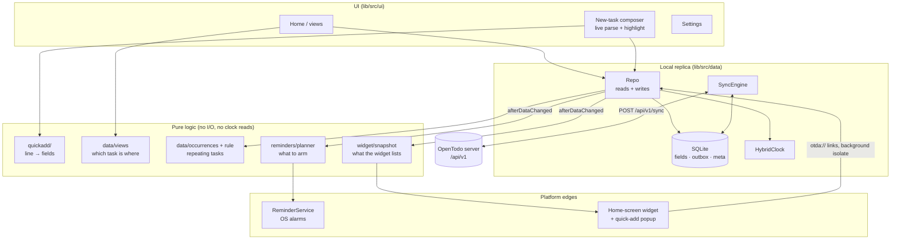

# Architecture and repository map

## What is here

| Path | What it is |
| --- | --- |
| `spec/API.md` | The confirmed API surface: **400 `/api/v1` operations**, every one probed against a live v1.5.0 server, AI surface excluded. |
| `spec/OTDA.openapi.json` | The same surface as OpenAPI 3.1, filtered to what this app uses. |
| `spec/*.py` | The scripts that produced it (route table of tag `v1.5.0` + live probes + the repo's OpenAPI). |
| `lib/src/api/` | HTTP client: bearer token or session cookie, error envelope, no redirects. |
| `lib/src/auth/` | Health check, password sign-in, second factor, step-up (`reauth`), token sign-in, TOTP enrolment/recovery codes/trusted devices. |
| `lib/src/data/` | The local replica: per-field last-writer-wins, op outbox, hybrid logical clock, sync engine, view rules, statistics, activity/history and export clients. |
| `lib/src/quickadd/` | The quick-add parser, ported from the web app with its shared vectors. |
| `lib/src/reminders/` | The reminder planner (pure) and the service that arms it with the OS. |
| `lib/src/widget/` | The widget snapshot builder (pure) and the widget's look settings. |
| `lib/src/ui/` | Screens and sheets: home, composer, task sheet, Trash, statistics, activity, invitations, export, workspaces, project sharing, public links, task pages, settings, admin. |
| `android/.../widget/` | The home-screen widget (plain RemoteViews with a scrolling list) and its project picker (Kotlin). |
| `test/` | Unit tests, parity fixtures (`inbox`, `views`, `quickadd` vectors), and integration tests against a real server. |
| `tool/parse_check.dart` | Prints what the parser makes of a line: `dart run tool/parse_check.dart "call Sam tomorrow 3pm p1"`. |

## Architecture at a glance

OTDA is three layers around one local database. Nothing in the UI talks to the
server; everything reads and writes the **replica** on the phone, and a sync
loop reconciles it with the server in the background.

Three rules hold the design together:

1. **One write path.** Every change — a tap in the app, a tick in the widget, a
   task typed into the popup — is a field write plus a queued op in `Repo`.
   It is visible at once and reaches the server on the next exchange.
2. **One trigger for side effects.** `AppState.afterDataChanged()` runs after
   every finished sync and every local change. It rewrites the widget snapshots
   and re-arms reminders, in that order, each in its own `try`, so a refused
   notification permission can never stop the widget updating.
3. **Pure cores, thin edges.** The parser, the view rules, the recurrence
   rules, the reminder planner and the widget snapshot are plain functions of
   their inputs (including "today" and "now", which are *passed in*). Plugins,
   the database and the clock sit at the edges. That is why most of the test
   suite needs no device.

### Process model on Android

| Entry point | What runs | Why it exists |
| --- | --- | --- |
| `main()` → `MainActivity` | The full app: `AppState`, sync loop (30 s poll plus a live event stream), UI. | Normal use. |
| `quickAddMain()` → `QuickAddActivity` | Only the composer, in its own transparent Flutter engine. | The widget's "+" opens fast over whatever app is in front and never touches the main UI. |
| `onWidgetAction()` (background isolate) | Opens the replica headlessly (`openHeadlessRepo`), applies the action, rewrites snapshots. | Ticking a task in the widget works with the app closed. |

The widget talks to Dart through `otda://` links (`task`, `new`, `complete`,
`refresh`, `upcoming`). `MainActivity` hands them to `SystemBridge`, which routes
them in `handleWidgetUri`.

