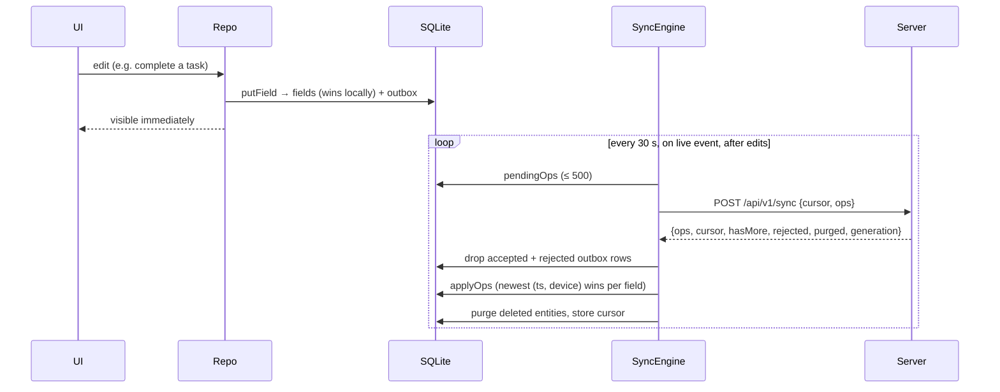

# The data model and sync

The server is a field-level last-writer-wins op log. This app keeps the same
shape locally: `fields(entity, entity_id, field, value, ts, device)`, plus an
`outbox` and a `meta` table. Every edit is `(ts, device)`-stamped, applied
locally at once, and pushed by the next exchange. Pulling applies the same
comparison, so a device that was offline for a week ends up identical to one
that never left.

- **Conflict rule.** `applyField` writes a value only if its `(ts, device)` is
  greater than the stored pair (timestamp first, device id breaks ties), so
  every replica picks the same winner per field, in any order.
- **Hybrid logical clock.** A stamp is `max(now + offset, last + 1)`, so a local
  write always orders after anything already seen. The clock adopts the
  server's time when the two differ by more than 2 s, so a phone with a wrong
  clock does not stamp far in the future.
- **Entities are bags of fields.** Rows are decoded maps keyed by the server's
  field names; a new server field shows up in `Task.raw` without a migration.
- **Deletes are tombstones** (a `deleted_at` field), so other devices learn of
  them; the server's `purged` list removes rows for good.
- **Server restored from backup?** The `generation` changes; the engine re-emits
  every stored field with its stored clock (`_reseed`) and reads the log again.
- **Failures.** An unreachable server is only reported after two failures in a
  row, in plain words (`FailureMeter`); a server that answered "no" is reported
  at once.
- **Repeating tasks** are a *series* plus one *occurrence record* per finished
  day (`series.dart`). Ticking a repeating task writes the record (its id is a
  deterministic UUID of `occurrence:<series>:<date>`, so every client lands on
  the same row) and moves the series to its next date, instead of completing it.
  `occurrences.dart` expands a rule into dated occurrences for the calendar,
  Upcoming and the reminder planner.
- **View rules** (`views.dart`) are ported from the web app and pinned by the
  `inbox` / `views` vectors, so OTDA lists exactly what the web app lists.

