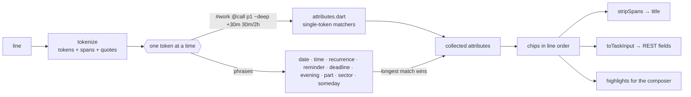

# The quick-add parser

`lib/src/quickadd/` turns one line of free text into a task:

```
Write report tomorrow #work @call p2 +45m
```

```json
{
  "title": "Write report",
  "due": { "date": "2026-10-10" },
  "project_id": "w",
  "labels": ["l-call"],
  "priority": 2,
  "estimate_minutes": 45
}
```

It is a port of the web app's `web/src/lib/nlp` (OpenTodo v1.5.0, including the
v1.8 dashed-range rule), kept behaviour-identical and checked against the **same
306 shared test vectors** the web and Go implementations run
(`test/quickadd/quickadd.vectors.json`). It runs
entirely on the device, so the preview works offline and updates as you type.

## Design principles

- **Pure and deterministic.** `parse(line, ctx)` depends only on the line, the
  reference date (`today`), the wall clock (`now`), the active languages, the
  project list and the dismissed spans. No clock reads, no randomness, no time
  zones (dates are floating `YYYY-MM-DD` strings, times floating `HH:MM`).
- **Never emit what the server would refuse.** Recurrence phrases are translated
  into the canonical English rule and only accepted if `parseRule` accepts them.
- **Explicit only.** The result carries only attributes the line actually set,
  so view defaults fill the rest (a bare `Buy milk` yields just `{title}`).
- **Quotes are literal.** Words inside a balanced pair of `"…"` are never
  matched by any grammar.
- **Cheap to get wrong, easy to undo.** Anything ambiguous prefers to stay in
  the title (a bare `4m` could be metres; `from September` is prose).

## Pipeline



| File | Responsibility |
| --- | --- |
| `tokenize.dart` | Splits on whitespace into `Token`s (`text`, folded `norm`, `start`, `end`, `quoted`) and reports the quote characters of balanced pairs. `stripSpans` builds the title by turning every recognised span into a word break, so `milk tomorrow p2` never glues words. |
| `vocab/` | One `Vocabulary` per language (`en`, `de`, `fr`, `it`, `es`, `pt`, `nl`): day words, weekdays, months, "in/at/on/by", units, am/pm, ordinals, recurrence words. `normalize()` folds case, diacritics and `ß`, so vocabularies are written in natural spelling. English is always active; extra languages are *added*, not swapped. |
| `attributes.dart` | The language-independent single tokens: `#project` (exact folded name, then unique prefix, `#Parent/Child` paths), `@label`, `p1`–`p4`, `~deep`/`~medium`/`~low`, durations (`+45m`, `+1h30`) and spent/estimate (`30m/2h`). |
| `dates.dart` | The date and time grammar and resolver: day words, weekdays, `next …`, ordinal weekdays, `in N <unit>`, `D month [year]`, numeric dates (order from the date-format preference), clock times (`3pm`, `15:30`, `noon`, Dutch `half 4`; a bare `15h` is a time only in a language that writes times that way — in English it is a 15-hour estimate). |
| `recurrence.dart` + `rule.dart` | Recurrence phrases → canonical rule (`every monday`, `every 2 weeks on saturday`, `every 3 days after completion`, `until`, `for N times`, "every other"), `parseRule`, `firstOccurrence`, and `compatibleRule` (written in the form a 1.0 client reads). |
| `reminders.dart` | `remind me 30 min before` (offset) or `remind me tomorrow at 9` (moment), and how a reminder resolves against the final due date. |
| `sectors.dart` | Time sectors (`this week`, `next quarter`) → the stored ISO week / month / quarter. |
| `parse.dart` | The loop that ties it all together, plus the `Chip`/`ParseResult` types and dismissal bookkeeping. |
| `types.dart` | The floating `Due` value the whole grammar returns (`date`, optional `time`); there is no time zone or instant anywhere in it. |
| `quickadd.dart` | The public entry point `parseQuickAdd`, `toTaskInput` (label and project resolution into the REST body), chip labels, Backspace/dismissal helpers. |
| `settings.dart` | Language resolution and numeric date order from the user's preferences. |
| `../quickadd_bridge.dart` | The app-side wrapper `parseLine`: supplies today/now, project refs, and converts chips to preview labels and highlights. |

## How one pass reads a line

`parse()` walks the tokens left to right, exactly once. At each token it tries,
in this order:

1. **Single-token attributes** (`#`, `@`, `~`, `p1`, durations). The first
   `#project` and the first priority win; every `@label` accumulates, and every
   `~energy` token is collected with the **last** one setting the value.
2. **Deadline words** — `deadline friday`, `by friday` (a `by` date followed by
   a time stays a due date instead).
3. **Evening / part words** — `tonight`, `this evening`; `this morning` /
   `this afternoon` when the account uses day parts. These also set today as the
   date when none came first.
4. **The phrase contest.** At the same token, a date, a time, a recurrence and a
   reminder matcher each report how many tokens they consume. **The longest
   wins; a date wins a tie.** Then the first date, first time and first rule are
   kept; reminders accumulate.
5. **Sector / someday** words, which only count if the line ends with no date.

Because matching is longest-wins, phrases that *contain* smaller phrases come
out whole:

| Line | Read as | Not as |
| --- | --- | --- |
| `gym every 2 weeks on Saturday` | one recurrence | a date plus a time plus text |
| `remind me tomorrow at 9` | one reminder moment | a due date and a due time |
| `lunch Monday, March 3` | one date (the 3 March) | a weekday and a date |
| `invoices from September` | text (a bare month after *from* stays prose) | a date |
| `September 3` | a date | — |
| `every 2 Mondays` | kept whole in the title (a *literal* match the grammar cannot express) | `every Monday` plus a stray `2` |

The same machinery implements a few deliberate asymmetries: a bare month is
replaced by a later complete date, a "someday" phrase is discarded if the line
has a date, and only the first recurrence rule counts after which only literal
matches are consumed.

## Examples

Reference for all of these: today is Friday **2026-10-09**, now is **10:00**,
English, a project named *Work* (`w`).

| You type | Title | Result |
| --- | --- | --- |
| `Water plants every Monday` | `Water plants` | recurrence `every monday`, due `2026-10-12` |
| `Call Sam tomorrow 3pm p1` | `Call Sam` | due `2026-10-10 15:00`, priority 1 |
| `Write report tomorrow #work @call p2 +45m` | `Write report` | due `2026-10-10`, project `w`, label `call`, priority 2, estimate 45 min |
| `Pay rent deadline friday` | `Pay rent` | deadline `2026-10-16` (no time: a time after a deadline stays in the title) |
| `Tidy desk tonight` | `Tidy desk` | due today, evening flag |
| `Read paper someday` | `Read paper` | parked (`start: someday`), no date |
| `Draft ~deep 30m/2h` | `Draft` | energy deep (if energy is on); spent 30 min of a 2 h estimate |
| `Stretch remind me 30 min before` | `Stretch` | reminder: 30 minutes before the due |
| `Standup every weekday at 9:30` | `Standup` | recurrence `every weekday`, due time `09:30` |
| `Buy "tomorrow" candles` | `Buy tomorrow candles` | no date: quoted words are literal, the quote marks are dropped |
| `Buy milk` | `Buy milk` | nothing but the title |

### Relative phrases: `in <n><unit>`

"In N units" works spoken (`in 4 minutes`, `in a week`) and compact. The
compact suffix is language independent, like `+30m`, and only counts directly
after an *in* word (`in` in English, `dans`, `tra`, `en`, `em`, … in the others):

| Suffix | Unit | Example | Resolves to (today 2026-10-09, now 10:00) |
| --- | --- | --- | --- |
| `m`, `min`, `mins` | minutes | `call in 4m` | due today **10:04** |
| `h`, `hr`, `hrs` | hours | `call in 2h` | due today **12:00** |
| `d` | days | `call in 3d` | due **2026-10-12** |
| `w`, `wk`, `wks` | weeks | `call in 2w` | due **2026-10-23** |
| `mt`, `mth`, `mths`, `mo`, `mos` | months | `call in 3mt` | due **2027-01-09** |
| `y`, `yr`, `yrs` | years | `call in 1y` | due **2027-10-09** |

Details worth knowing:

- Minutes and hours are a **time** (wall-clock now plus the amount, on the day
  it lands on): `in 4m` typed at 23:58 gives `00:02` tomorrow. Days and longer
  are a **date**. Months clamp to the end of a shorter month.
- A bare `m` is **minutes**; months are `mt`/`mo`/`mth`. A leading `+` is
  unchanged and always means *duration*: `write +4m` is a 4-minute estimate, not
  a due time.
- Without `in`, a bare `4m` is left alone in the title (it could be metres).
- Minutes and hours need a wall clock (`now`); without one only the date forms
  resolve.

### What "understood" looks like: chips

Each recognised attribute becomes one **chip**: its `kind`, the character
`spans` it came from, and its resolved `value`.

```text
line:  "  call tomorrow 3pm p1"            (two leading spaces, as typed)
chips: due      spans [tomorrow] [3pm]   → Due(2026-10-10 15:00)   spanKinds [date, time]
       priority spans [p1]               → 1
```

The preview chips under the input are `chipLabel(chip)`. A `due` chip may own two
spans (the day phrase and the clock phrase); `spanKinds` says which is which.

### Live highlighting

While you type, every understood phrase is coloured by kind, the way TickTick
does it (`ui/highlight_controller.dart`):

| Kind | Colour | Kind | Colour |
| --- | --- | --- | --- |
| date | blue | project | green |
| time | amber | label | cyan |
| recurrence | purple | priority | orange |
| reminder | pink | energy | lime |
| deadline | red | estimate / spent | gold |
| evening / part of day | indigo | someday / sector | teal |

How it stays smooth:

1. `parseLine` returns a `ParseHighlight(start, end, kind, text)` per span.
   Offsets are shifted back onto the line **as typed**, because the parser sees
   the trimmed line.
2. The composer parses after a 180 ms pause and hands the list to its
   `HighlightingController`.
3. Parsing lags behind typing, so a highlight is only painted while the text at
   its position is *still the same*. Typing after a phrase keeps it coloured;
   editing inside it drops the colour until the next parse.
4. `buildTextSpan` cuts the text at every highlight and IME-composing boundary,
   so the keyboard's composing underline survives.
5. The controller's listener only re-parses when the **text** changed (not on
   caret moves or its own highlight updates), which avoids a notify loop.

### Dismissals

The port includes the web app's "Backspace un-parses the last chip" bookkeeping:
`chipAtCaret`, `dismissChip`, `liveDismissals` and `rebaseDismissed`. A dismissed
span is skipped while the line still has exactly that text there, and is shifted
or dropped as the line is edited. (The composer does not wire a Backspace
gesture to these yet.)

## Composer: who owns each value

The new-task sheet has both a typed line and tappable controls (date, time,
duration, repeat, priority, project). `ComposerState` records **who set each
field**:

- A value a control set is *manual* and the line never overwrites or clears it.
- A value from the line is cleared when the line stops saying it — delete the
  word `tomorrow` and the date goes.
- Clearing a control releases the field so the line may fill it again.

`composeTaskFields` merges the two when saving. Label names from the line are
resolved to ids (created on demand) by `Repo.resolveLabelNames`. Reminders and
spent time parsed from the line are shown in the preview but not yet written;
they need their own calls.

## Adding to the grammar

- **A new word in an existing language** → edit its `vocab/<lang>.dart`.
- **A new language** → add a `Vocabulary`, register it in `vocab/index.dart`.
- **A new phrase shape** → add a matcher to `dates.dart` / `recurrence.dart` /
  `reminders.dart` returning *token counts*, so the longest-wins contest in
  `parse()` arbitrates it for free.
- **Always** add a case to `test/quickadd/` (and, for shared behaviour, the
  vectors file, which must stay identical to the web copy).

