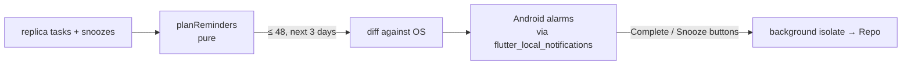

# Reminders

- `planner.dart` is pure: every open occurrence in a 3-day window that is still
  ahead becomes a `PlannedReminder`. A task with a date but no time uses a
  default (09:00, configurable). Wall-clock times are built in the device's time
  zone, so 9:00 stays 9:00 across a daylight-saving change. The id is a stable
  31-bit hash of `taskId|day`, so the same occurrence replaces the same alarm.
- `ReminderService.rearmFrom(repo)` is the **only** thing that schedules
  anything; calls queue up so a re-arm requested during another is not lost.
- Snoozes are a per-device decision and are **never synced**.
- Settings → Notifications shows permission, exact-alarm and battery state, and
  has test buttons and a copyable debug log.

